# How scanning works

The scanner reads a DiceKey from the camera: 25 dice in a 5x5 box, each showing a letter, a
digit and a rotation. It lives in `Packages/ReadDiceKey/Sources/ReadDiceKey/`, is written in
Swift, and uses only system frameworks (Foundation, with Dispatch, `simd`, CoreGraphics and
CoreVideo, and CoreText and Accelerate to read the printed text) and the package's own
`DiceKeySpecification` module. This document explains what it reads, how, and why it works
this way rather than the alternatives that were measured.

Steps 2 and 3 follow DiceKeys' own scanner,
[read-dicekey](https://github.com/dicekeys/read-dicekey) (C++ on OpenCV), in how they find
and decode the bars, so `Bars.swift` and `Undoverline.swift` are derivative works
(`THIRD_PARTY_LICENSES`). The rest is this scanner's own design. "Against read-dicekey"
measures the two on the same photos.

## What it is built for

- **Never read a key wrong.** A misread face derives different secrets, silently. Every rule
  below leans toward reading nothing rather than guessing.
- **Read a well-framed key within a few frames on a phone,** and leave the phone cool doing it.
- **Stay small enough to maintain:** Swift, no dependencies, and system frameworks only where
  they measurably do the job.
- **Not a goal: photos far outside what the scanning overlay asks for.** A steep tilt, blur or
  a cropped key may read nothing, but must never read wrong.

## What a face carries

Every face has two layers of information.

- **For people:** a letter (A to Z, without Q) and a digit (1 to 6).
- **For machines:** a black bar under the text (the underline) and one over it (the
  overline). Each bar has 11 dot positions; a white dot is a 1. Read from the letter end, the
  11 bits are a 1, a flag that is set on the overline, an 8-bit code, and a 0.

```
            letter end ─────────────────────────────► digit end
  dot:        1      2         3  4  5  6  7  8  9  10     11
  bit:        1   overline  └──────── 8-bit code ───────┘   0
```

The bars are what the scanner reads, and they carry everything:

- **Which face.** 150 faces use 150 of the 256 underline codes and 150 of the 256 overline
  codes.
- **Which way it is turned.** The 1 is at the letter end and the 0 at the digit end, so the
  direction the bits run is the direction the face reads.
- **A cross-check.** A face's two codes are different numbers that name the same face. Every
  one of the 150 underline codes and 150 overline codes is one bit away from another valid
  code, so a single line can be misread without anything noticing. But turning one face into
  another *with both lines agreeing* takes at least four wrong dots across the two lines, in
  the right places: every face has another exactly four away, split 1 and 3, 2 and 2 or
  3 and 1 between its underline and overline. That protects against errors that strike the
  lines independently, not against one cause striking both: a cover or the frame's edge over
  the same end of both bars wrongs the same dots of both. Step 4 keeps such lines from
  agreeing on their own.

A face counts as read when its underline and overline, both found as bars, name the same
face, or when one of them names it and its printed letter and digit, compared with all 150
faces, clearly pick it too (step 5). A line read only where the grid puts it, because no bar
was found for it, never counts without the text (step 4). Over the photo corpus neither rule
has ever accepted a wrong face.

The 150 faces with their codes, and the whole printed layout, are in the `DiceKeySpecification`
module, generated by DiceKeys' specification generator (written in TypeScript), along with the
font they are printed in, Inconsolata Bold. The scanner reads with it and the app draws dice
from it.

## The pipeline

Each camera frame goes through six steps.

```mermaid
flowchart LR
    A["Camera frame (Y'CbCr)"] -->|"1. centered square of the luma plane"| B[Gray image]
    B -->|"2. 12 thresholds, keep bar-shaped dark regions"| C[Bars]
    C -->|"3. sample 11 dots, decode"| D[Undoverlines]
    D -->|"4. fit the 5x5 grid, read each slot"| E[Faces in 25 slots]
    E -->|"5. read the text where the lines disagree"| G[Faces settled]
    G -->|"6. merge with earlier frames"| F[DiceKey]
```



### 1. The frame (`GrayImage.swift`, app `CameraSession`)

The camera delivers bi-planar Y'CbCr. Its first plane is luma, which already is the grayscale
image the scanner needs, so the scanner takes the centered square of it (what the square
preview shows) with one copy per row. AVFoundation rotates the buffers to match the preview
before they arrive, so the scanner works in the coordinates the user sees.

### 2. Finding bars (`Bars.swift`, `Regions.swift`)

A bar is dark against its own die, but the light across a key is rarely even: glare on one
corner, a shadow over another. No single brightness threshold separates every bar from its
die, but for each bar some threshold does. So the frame is thresholded at twelve levels
(`k * 255 / 13` for k = 2 to 13, skipping levels above the brightest pixel), and at each the
dark pixels are grouped into regions: runs of dark pixels along each row, joined where runs in
neighboring rows share a column. At the right level, each bar is a region of its own.

Each region of at least 50 pixels is fitted with its smallest enclosing rectangle (one side
lies along an edge of its convex hull), and kept if it has an undoverline's proportions: 0.177
as thick as it is long, within a factor of 1.5 either way. The levels are independent, so they run in
parallel.

Most regions are not bars (paper texture, the box, letters, the scene), so two facts about a
key thin them out:

- **All 50 bars are the same size.** The areas are sorted and the tightest run of 35 found;
  only candidates with an area from 0.75 to 1/0.75 times its middle area stay. A tight run of
  much larger rectangles wins over a tight run of tiny ones, so specks of equal size cannot
  outvote the bars.
- **A bar is found at several thresholds.** Of overlapping candidates (either's center inside
  the other), the one closest to that area stays.

### 3. Reading a bar (`Undoverline.swift`)

The dots are read along the line through the middle of the rectangle, so first its two ends
are found. A rectangle found at one threshold can take in a little of what the bar touches, or
miss a blurred end, so each end is put where the brightness drops most steeply into the bar,
searching within 3% of the bar's length either side of the rectangle's end. An edge stays put
where a fixed brightness would not: a metallic sheen on the ink, or a shadow on the die just
past the bar, moves where a threshold is crossed by several pixels, enough to slide the dots
onto their edges.

The 11 dots are sampled along the line, each the median of up to 21 pixels around its center
(fewer when the dots are small), and split into dark and light at the brightness that leaves
the two groups tightest, with at least four dots on each side (every code has 4 to 7 light
dots). The split must be clear: the gap between the lightest dark dot and the darkest light
one must be at least a fifth of the distance between the two groups' mean brightness, or the
line is not read, since dots that barely split could as well have split elsewhere, into
another code. In a frame saved from the app, motion blur along the bars made both bars of one
die read the same wrong face, and this rule refuses them; it also refuses the one face of the
corpus video the scanner otherwise read wrong. It drops 1.6% of the lines that read right and
28% of those that read wrong.

The bits decode into the face, whether the line is an underline or an overline, and which end
is the letter end. A code that no face has is a misread, and the line is dropped; step 4,
finding its slot without that line, reads it again where the grid puts it.

### 4. Assembling the grid (`GridFit.swift`, `Grid.swift`, `Slots.swift`)

Each line says where the middle of its face is: 0.41 of a face from its own middle, toward the
text. A die's two lines say the same place, and the dice of a key lie a step apart along its
rows and columns. The grid is fitted to the face middles of all the lines read, whether or not
a line's partner was found, and then each of the 25 slots is read where the grid puts it.

- **Step and direction.** The step from die to die is the median distance from each face
  middle to the nearest one more than 0.8 of a face away, which is on another die; a step
  shorter than a face cannot be dice side by side. Rows run in the direction the lines share:
  their angles, multiplied by four so that the four turns of a face become one direction, are
  averaged, and the mean divided by four lies within 45 degrees of the frame's x axis, so row 0
  is the top of the key as the camera sees it.
- **Anchor.** Each face middle in turn is tried as column 0 and row 0 of a flat grid with that
  step and direction. The one that puts the most face middles within a quarter step of a whole
  column and row is kept.
- **Flat refits.** The grid is refitted to those face middles by least squares three times,
  flat (rows and columns straight, parallel and evenly spaced), gathering the middles on whole
  columns and rows afresh each time.
- **Strays.** While the middles span more than five columns, the outermost column with fewer
  lines (the lower one on a tie) is dropped if it holds no more than two, one die's worth: a
  die beside the key, or a line read on something else. With one column too many, it is
  dropped only if the column at the other end has lines in at least three slots. Otherwise
  either end could be the strays, as when a column of the key shows one die beside two stray
  dice, and the frame reads nothing. Then the same for rows.
- **Perspective.** With at least 16 lines left, the grid is refitted three times in
  perspective, where rows converge and dice shrink with distance, each time gathering the
  middles afresh but only within one column or row of those the flat grid kept. Strays are
  then dropped again.
- **Pinning.** The grid is the key's when the lines left lie in each of five columns and five
  rows side by side and in no others, number at least 8, make up at least 60% of all the lines
  read in the frame, and fill at least two slots of each outermost row and column; and every
  line in their slots is much the same length in columns and rows: none more than half the
  median off it. Their first column and row become column 0 and row 0. Otherwise the frame
  reads nothing.
- **Reading at the grid.** Each line goes to the slot its face middle is in, within a quarter
  step of the slot's middle along each axis; of two lines of a kind in one slot, the one nearer
  the middle is kept, and a line much shorter than the rest is left out (next). Then each slot
  missing a line is read where the line must be, which recovers lines too faint or broken up to
  be found as rectangles, or too near or far for their size to pass as one. A line the slot
  holds says where its face's other line is; in a slot holding neither, bars are tried on all
  four sides of its middle. These bars are placed in columns and rows, where every face is the
  same square however perspective shows it (its side the median length of the lines read,
  measured in columns and rows), and only then mapped into the frame, so perspective cannot
  stretch them. A bar is read this way only if both its ends are in the frame: past the frame's
  edge a dot samples as dark, so a bar the edge cuts reads as another code. A line read this way
  fills the slot if the slot still lacks its kind and its face middle is in that slot. Reading
  bars the edge cuts read 2 more faces from the `other/` photos over the four sizes and 3 more
  from the saved frames, and completed a synthetic key wrong; refusing instead every line with
  an end outside the frame, however it was found, read 72 fewer from the `other/` photos and 81
  fewer from the saved frames.
- **Lines cut short.** The frame's edge, or a cover such as glare or a light finger, can cut a
  bar short at its digit end and leave it passing as a bar, since step 2 keeps rectangles down
  to three quarters of the bars' area. Its dots are then sampled along the shortened length and
  fall on the wrong dots of the code, the same ones on both bars of a die cut at the same place,
  so both name the same wrong face and agree: R5 for R4 in synthetic frames. A line that
  measures under 0.95 of the median line's length on the grid is left out. Its slot is read at
  the grid instead, where the bar is refused if the frame cuts it and the line is otherwise one
  the text must confirm (next). With the frame's edge cutting the digit end of every face,
  upside down, at 22,950 synthetic positions, and a cover in the die's own white over it at
  3,900, 0.95 left no face wrong; 0.92 left 6 and 4 wrong. Leaving out only short lines that end
  at the frame's edge would miss the cover. The rule reads 2 fewer faces from the well-framed
  photos over the four sizes, 1 more from the `other/` photos and 2 more from the saved frames.
- **A line read at the grid is no vote on its own.** The lines of a slot settle its face alone
  only when both were found as bars and agree. A line read at the grid, where no bar was found,
  needs the text (step 5) to name the face too. Whatever kept a bar from being found, such as a
  finger or the frame's edge over its digit end, can make it name the same wrong face as the
  line beside it, or as the other line read there: a cover or a dark band across the same dots
  of both turns L4 into L3 or H5 into F5 on both lines in synthetic frames. And where there is
  no bar at all, noise decodes a face by chance: with every underline left off a synthetic key,
  reading its place gave a line in 871 of 11,424 slots at sensor noise of 4 to 14 gray levels
  (none at 0), and in 6 of them the line named the face of the overline beside it. With an L1's
  underline washed out and one dot of its overline smudged, so that it names L3, the blank place
  read as L3's underline in 8 of 6,000 frames at noise 4 before the rule and in none of 6,000
  after; one such frame beside a clean frame of the other 24 dice completed a wrong key. The
  text is an independent vote where that leaves it alone. A band across the bars misses it, but
  the frame's edge cuts it with the bars: a die cut in half read K3 as K1 on its bar and its
  text alike, which is why bars the edge cuts are not read at the grid. Against trusting such
  lines, the rule reads 16 fewer faces from the `other/` photos over the four sizes, 141 fewer
  from the saved frames and 4 fewer from the well-framed photos; slots with both lines read at
  the grid, which it first covered, account for 4, 15 and none. A key is complete one frame
  later in two of the four saved sets, at frame 46 and 41 instead of 45 and 40.
- **Rotation.** Each face's turn is its reading direction relative to the grid's rows at its
  slot, in quarter turns.

**Why each gate is there.** Dice that are not a key can line up too, so the grid has to show
it is the key's before any slot is read.

- **Exactly five columns and rows:** the slots are the key's 25. With a whole column or row
  out of view, nothing says which one is missing.
- **Lines in every column and row:** a grid fitted across a tilted key whose bottom row was
  out of view put the lines of the key's first, second and fourth rows in rows 0, 1 and 4,
  with nothing between, and read the fourth row as the fifth. This reads 1 fewer face from
  the `other/` photos at the app's scale, none fewer from the saved frames.
- **Faces of one size on the grid:** every face is the same square in columns and rows, so a
  line much longer or shorter there than the rest means the grid is stretched. A key turned
  and steeply tilted pinned a grid stretched over all five rows that read six faces wrong; its
  lines measured up to 0.80 of the median off it. On a grid that fits, nearly every line
  measures within a few percent of the median; the farthest are 0.22 off in the corpus and
  0.40 in the saved frames, where they are single lines measured long. The gate costs no face.
- **60% of the lines on the key:** scattered or jumbled dice put 31 to 41% of their lines on
  the best grid, a key at least 69%.
- **Two slots in each outermost row and column:** in a frame saved from the app, a single
  stray line past the key's edge would otherwise have pinned the grid a column off. A die
  beyond the edge fills one slot, never two.

### 5. Reading the text (`FaceText.swift`)

After step 4, a slot whose two lines were found as bars and name the same face is read. A
slot with at least one line but no such agreement, because a line is misread or was not found
as a bar and so was read only where the grid puts it, gets a second chance from its printed
letter and digit. Every other slot is left alone, so a frame whose lines all agree skips
this step.

**Matching.** Each of the 150 faces' letter and digit is drawn once, in Inconsolata Bold at the
printed size and place, as a grid of 48 samples across the face over the band between the
bars. The die's band is sampled the same way, at its center, size and reading direction as its
lines give them, and correlated with every face's, shifting up to three samples either way for
error in its center. The face with the highest correlation is the text's best match.

**Settling.** The best match settles the slot only when all of these hold:

- it is a face one of the slot's lines names, so the text is a second vote beside a bar, never
  a vote on its own;
- it scores at least 0.7 and leads the next face by 0.03;
- it leads the best match at each other quarter turn by 0.15, so its orientation is right;
- it is still the best match when the die is sampled at the size the other dice predict for
  that slot, so its size is right. The prediction is a plane over rows and columns fitted to the
  sizes of the dice whose lines agree, since perspective changes size smoothly. It needs at
  least three such dice, not all in one line, and where it is less certain than one die's own
  measure, as far from the few agreeing dice of a sparse frame, nothing is settled;
- no other die in the frame reads the same letter, by its lines or by its text, since a key
  has one die per letter. Two slots whose text reads the same letter are both left unread.

A face settled by text then counts like any other in step 6.

**Why each check is there.** The text match alone is not safe. On the 3,630 corpus dice whose
two lines were found and agree (all four sizes), the best match was the right face every time,
but only at the die's true orientation and size. Read a quarter, half or three quarters of a
turn off, or at 85% to 120% of its true size (in steps of 5%, 10 readings of each die),
another face matched clearly enough to pass the score and lead 1,070 times: 293 turned, 777
resized. A die whose lines disagree is exactly where the size can be wrong, since a broken bar
measures short. The quarter-turn lead refused all 293 turned matches and the size check all
777 resized ones, at the size the other dice predict as well as at the true size; fitted to
the other dice, the plane predicts a die's size within 3.4% in 98 cases of 100. Shifting the
center by a quarter of the step between dice, the most a line's face middle can lie from its
slot's middle and still be placed in it (0.41 of a face at the median), is a conservative
bound on the error in the center the text is sampled at: that is the middle of the die's own
lines, which slot placement does not move, and a die's two lines agree on it within 0.1 of a
face in 99 cases of 100. It made a wrong face pass the score and lead 2 times in 29,040 (8
shifts of each die), and the quarter-turn lead too once. A misread would now need a misread
line to name exactly the face the text wrongly matches, while passing every check.

On an M4 Pro, drawing the 150 faces takes 3 ms on first use, and reading one die's text about
1 ms.

### 6. Across frames (`DiceKeyScanner.swift`)

One frame rarely reads all 25 faces; the scanner keeps what every frame has read. The grid is
fitted afresh each frame, so the key may have turned a quarter turn in between (or been read
that way when held near 45 degrees). The known faces are tried in all four turns, and the turn
that agrees with the new frame on the most faces and disagrees on none is kept. If every turn
disagrees somewhere, the camera is on another key and reading starts over. Five faces in
common are needed to call it the same key, because two keys can share a face or two by
chance. With fewer, whichever of the two reads has more faces stands, so one key is not mixed
into another on a coincidence. Successive frames of a key in view read most of its faces, so
they share far more than five. A frame that reads nothing changes nothing.

When all 25 faces are known and name 25 different letters, the key is read: a DiceKey has one
die per letter, and a full sheet of Stickeys stickers, which repeats five letters, would
otherwise read as a key. This is also the last guard on step 5's letter check, which sees only
one frame.

Stickeys, DiceKeys' stickers for backing up a key, carry the same bars and layout as the dice,
larger, with no box around them. A kit holds "150 stickers (one for each die face)", and the
backup is "a 5x5 grid of stickers that matches your DiceKey"
([DiceKeys FAQ](https://dicekeys.com/faq/)), cut from sheets of five letters with every digit
([`StickerSheetView.tsx`](https://github.com/dicekeys/dicekeys-app-typescript/blob/main/web/src/views/SVG/StickerSheetView.tsx)).
A backup can repeat letters: DiceKeys' own app checks for one of each letter only when asked
([`validateDiceKey.ts`](https://github.com/dicekeys/dicekeys-app-typescript/blob/main/web/src/dicekeys/DiceKey/validateDiceKey.ts),
`requireOneOfEachLetter`, false by default). `diceKey` refuses such a key, since it needs 25
different letters, and step 5's letter check never settles a die whose letter another die in
the frame shows. By inference, stated nowhere: one kit has each face once, so a backup that
repeats a letter does so with different digits, or with stickers from a second kit.

## Speed

`ScannerBenchmarkTests` is opt-in (`SCANNER_BENCHMARK=1 swift test -c release --filter
ScannerBenchmark` in `Packages/ReadDiceKey`) and times a scan of one 1080x1080 frame, the
app's square, whose lines all agree. On a Mac it takes a few milliseconds (3.6 ms on an M4
Pro) and raises peak memory by about 13 MB. Each die step 5 reads adds about 1 ms. No phone
has measured it (`backlog.md`).

## Accuracy and the corpus

`ScannerCorpusTests` runs photos and a short video of keys: read-dicekey's, the owner's (one key
is the one printed in the DiceKeys booklet), and scenes with no key. The bar depends on
how a photo was taken, not on who took it:

- **A well-framed key must read** (the photos in `well-framed/`) at the app's scale (the
  shorter side scaled to 1,080 pixels, uncropped, since the photos were not framed through
  the app's square): at least 20 faces from one frame of each such photo, both filling the
  frame and at three quarters of that size, as a key held back to fit the scanning target,
  a window over the middle three quarters of the frame; and a recorded total across them
  all, a little below the 843 they read at the app's scale.
- **Everything else must only never be misread** (the photos in `other/`): a steep tilt, low
  light, blur, a key far away under glare, a cropped key, the video at 360 pixels, and scenes
  with no key at all (loose and jumbled dice, printed faces, Stickeys sheets, a sudoku grid),
  which must read nothing.

Every photo is checked for misreads at full size, at the app's scale and three quarters of
it, and cropped to the centered square exactly as the app scans it. No face has been read
wrong in any of them. The photos far outside what the scanning overlay asks for are there to
prove that, not to be read.

## Against read-dicekey

`scripts/compare-upstream/compare-upstream.sh [work dir]` reads the corpus with read-dicekey as
well as with this scanner and prints the tables below, and one row per photo and size. It
builds OpenCV 4.12.0, the version read-dicekey pins, and read-dicekey at commit 0440036 in the
work directory (about 90 s, then about 30 s for each rerun on an M4 Pro), and needs Xcode, git,
python3 and the network. Reruns give these faces exactly; times move by a millisecond or so.

Both scanners read the same gray bytes, which `UpstreamCompareTests` writes as PGMs: one frame
per photo at the four sizes of the corpus tests (full size; the shorter side 1080, the app's
scale; the centered 1080 square the app scans; the shorter side 810), scored by the corpus
tests' rules. read-dicekey runs `DiceKeyImageProcessor::processImage`, its grayscale entry, with
a fresh processor per photo, so nothing is merged. A face counts as read when its `isDefined()`
says so: letter and digit each a majority of two of underline, overline and its OCR, and an
orientation. It keeps a frame's faces only when its grid fits five rows and columns of
underline and overline pairs, and otherwise reads nothing from the frame. OpenCV runs its
arm64 code paths here; other CPUs take others, which may move a face or two.

Faces right/wrong:

|  | full size | shorter side 1080 | centered 1080 square | shorter side 810 |
|---|---|---|---|---|
| well-framed (34 photos, 848 faces): this scanner | 815/0 | 843/0 | 787/0 | 840/0 |
| read-dicekey | 778/0 | 760/0 | 683/0 | 784/1 |
| read-dicekey, keys it calls complete | 20 of 34 | 20 of 34 | 18 of 34 | 21 of 34 |
| other (12 photos, 295 faces): this scanner | 129/0 | 127/0 | 128/0 | 130/0 |
| read-dicekey | 39/0 | 62/0 | 80/0 | 43/1 |
| read-dicekey, keys it calls complete | 0 of 12 | 0 of 12 | 0 of 12 | 1 of 12 |

By whose photo it is, faces right, this scanner / read-dicekey:

|  | full size | shorter side 1080 | centered 1080 square | shorter side 810 |
|---|---|---|---|---|
| read-dicekey's own well-framed (19 photos, 475 faces) | 473 / 473 | 475 / 473 | 467 / 443 | 475 / 473 |
| the owner's well-framed, added later (15 photos, 373 faces) | 342 / 305 | 368 / 287 | 320 / 240 | 365 / 311 |
| read-dicekey's own `other/` (3 photos, 75 faces) | 64 / 19 | 65 / 42 | 66 / 42 | 67 / 43 |
| the owner's `other/` (9 photos, 220 faces) | 65 / 20 | 62 / 20 | 62 / 38 | 63 / 0 |

- **On read-dicekey's own well-framed photos the two are level:** they read the same at full
  size, and read-dicekey is two faces behind at each shorter-side size. On the centered square
  it reads 30 fewer faces than at its other sizes, 25 of them from `S4tI3lZ2t…_well_lit`, which
  it reads not at all there (this scanner reads 21).
- **The gaps are on the later photos and on read-dicekey's own `other/` ones.** It reads
  nothing from either Mac-camera frame of `W1tO4tC6l…` except 17 faces of one at full size,
  nothing from `D32T52S20…-webcam-tilted-1` at three sizes, nothing from
  `P5lU2lY5r…-blurry` at three, and nothing at any size from
  `D32T52S20…-webcam-left-column-cut` or `U5bC4bE1l…`.
- **Misreads:** this scanner has none at any size. read-dicekey has two, both at shorter side
  810: `G5bS2rW5l…-glare` U4b read as A3l, and `Y6bS2rG4b…` N4b as N3b. It flags both as
  errors (`errorSize()` 10 and 255), and neither frame passes its complete-key check.
- **No key:** neither reads a face from any of the nine `nokey-` photos at any size, and
  neither fails on `CausedCrashOn2020-09-18`, read-dicekey's crash-regression input. This
  scanner reads 20 faces there, whose letters and digits match the printed key by eye (the
  photo names no key, so they are not scored); read-dicekey reads none.
- **Video,** 95 frames of 360-pixel luma squares: read-dicekey fits its grid in frame 0 only
  (18 faces right, none wrong) and never finishes. After every other frame its read is empty,
  since it clears the read whenever a frame does not fit. This scanner, merging, knows all 25
  faces by the end with no wrong face in any frame; one frame at a time, it reads faces in 79
  frames, 21 at most.
- **Time per frame,** median, scanning only: this scanner 10, 6, 4 and 4 ms at the four sizes,
  read-dicekey 58, 24, 21 and 15 ms.

What the numbers do not say:

- **This scanner was tuned on these photos,** which are its test suite. read-dicekey's own
  tests use 23 of them, and on the 19 that are well-framed the two are level. Several of the
  owner's names record what this scanner read, checked by eye where the picture is sharp
  (`Fixtures/images/README.md`), so a face this scanner consistently misread would score
  read-dicekey's correct read as wrong. Neither of read-dicekey's two misreads is on such a
  photo.
- **"Read" is read-dicekey's own bar,** which counts faces it flags (`errorSize()` above 0);
  its apps show those to the user to confirm. Counting only its faces without a flag, it reads
  6 to 14 fewer per size from the well-framed photos and none wrong. This scanner's bar sits
  between: both bars agree, or one bar and clear text.
- **One frame is harsh on both,** since both are built for a camera loop. read-dicekey runs
  until it finishes and forgets the key on any frame without a grid; this scanner merges
  frames and keeps what it knows through such a frame. The corpus tests call a single frame
  stricter than the app.
- **The times are not alike.** This scanner traces its threshold levels in parallel
  (`DispatchQueue.concurrentPerform` in `Bars.swift`) and was timed inside `swift test -c
  release`. read-dicekey's levels run in series (OpenCV may parallelize single filters), and it
  was built `-O3` and timed warm, every photo in one process. Decoding and resizing are not
  timed.

## Constants and where they come from

The scanner's thresholds are in `Tuning.swift`, one group per step: `Tuning.Bars`, `Tuning.Lines`,
`Tuning.Grid`, `Tuning.Slots`, `Tuning.Text` and `Tuning.Merge`. The printed geometry they work
with is `FaceDimensionsFractional` in `DiceKeySpecification`.

| Constant | Value | Why |
|---|---|---|
| `Tuning.Bars.thresholds` | `k * 255 / 13`, k = 2...13 | read-dicekey's choice, kept after measuring fewer: k = 2, 4, ... 10 loses every face of the `fingers` photo in the centered square, and of 200 random sets of 4 or 5 levels only 3 came within 2 faces of all twelve at every size, so a smaller set would be tuned to these photos |
| `Tuning.Bars.minimumRegionPixels` | 50 pixels | Drops specks before rectangle fitting; a bar is far larger at any usable distance |
| `Tuning.Bars.proportionSlack` | 0.177 thick per length, within a factor of 1.5 | The printed geometry, with slack for blur and perspective |
| `Tuning.Bars.modalRunHalfWidth`, `largerRunTightness`, `largerRunFactor`, `areaTolerance` | tightest run of 35 (17 either side of its middle), or a run under 1.2 whose middle is over 3 times the area found so far; keep 0.75 to 1/0.75 times its middle area | 50 bars of one size; 35 leaves room for missed and extra bars |
| `Tuning.Grid.sameDieDistance` | face middles within 0.8 of a face | A die's two lines put its middle in one place, within 0.1 of a face in 99 cases of 100; the next die's is 1.3 to 1.9 faces away (well-framed photos, app's scale) |
| `Tuning.Slots.tolerance` | a quarter step along each axis | Unambiguous: slots are a whole step apart. The fit gathers the faces on the grid with it too |
| `Tuning.Slots.minimumLineLength` | 0.95 of the median line's length on the grid | A bar cut short still passes as a bar, and both bars of a die cut at the same place name the same wrong face. At 0.92 R4 still read as R5, and 6 of 22,950 edge-cut and 4 of 3,900 covered synthetic frames read a face wrong; at 0.95 none did. It reads 2 fewer faces from the well-framed photos over the four sizes, 1 more from the `other/` photos and 2 more from the saved frames |
| `Tuning.Grid.refits` | 3, flat and again in perspective | Two read the same faces as three or four over the corpus and the saved frames; one refit read 2 fewer from the well-framed photos (one at full size, one at three quarters of the app's scale) and 1 fewer from the saved frames |
| `Tuning.Grid.minimumLines` | 8 | Pinning needs lines in at least seven slots anyway; 4 and 6 read the same faces over the corpus and the saved frames |
| `Tuning.Grid.minimumLinesForPerspective` | 16 | Perspective only refines a flat grid that many lines hold, since fitted to sparse dice it misread. Without it the well-framed photos read 34 fewer faces at the app's scale |
| `Tuning.Grid.perspectiveWindow` | one column or row beyond the lines the flat grid kept | Gathering anywhere caught dice five rows past the key and lost a well-framed photo |
| `Tuning.Grid.maximumStrayLines` | an outermost column or row with at most 2, the one with fewer lines, the lower on a tie | One die's two lines: a die beside the key, or a line read on something else |
| `Tuning.Grid.minimumSlotsOppositeStrays` | 3, when the lines span one column or row too many | Two stray dice fill two slots, so a column of the key showing one die beside them would otherwise be dropped in their place, reading the key a column off. It costs no face over the corpus and the saved frames; 4 read 1 fewer from the `other/` photos, 5 also 16 fewer from the saved frames. Asking it at any span refused a well-framed photo at three quarters of the app's scale with single stray lines ten rows apart |
| `Tuning.Grid.minimumShareOnKey` | 60% of the frame's lines | Scattered or jumbled dice put 31 to 41% of their lines on the best grid, a key at least 69% |
| `Tuning.Grid.minimumSlotsOnEachEdge` | 2 | A die past the key's edge fills one; without this, one stray line there pinned a saved frame's grid a column off |
| `Tuning.Grid.maximumFaceSideDeviation` | half the median length of the lines in the key's slots, in columns and rows, either way | A grid stretched by a steep tilt measured 0.80 off; grids that fit, at most 0.22 over the corpus and 0.40 over the saved frames. It costs no face |
| `Tuning.Grid.smallestPivot` | 1e-9 | The fit is in columns and rows, small numbers; points in one line, which cannot fix a grid, leave a pivot of rounding error |
| `Tuning.Merge.minimumFacesInCommon` | 5 | Too many to match by chance; frames of a key in view share far more |
| `MinNumberOfBlackDotsInUndoverline`, `MinNumberOfWhiteDotsInUndoverline` (`DiceKeySpecification`) | 4 and 4 | Every code has at least 4 of each |
| `Tuning.Lines.minimumDotGap` | a fifth of the distance between the dark and light means | Drops 1.6% of the lines that read right and 28% of those that read wrong |
| `Tuning.Text.gridWidth`, `band` | 48 samples across a face, one per pixel of the drawn faces, over 0.22 to 0.78 of its height | The band clears both bars, reaching their inner edges at the largest shift; at this size the best face was the right one for all 3,630 dice whose lines were found and agree. Averaging 2x2 or 4x4 per sample read no more |
| `Tuning.Text.maximumShift` | up to 3 samples, about 6% of a face, either way | Covers the error in a center inferred from one line |
| `Tuning.Text.maximumSizeVariance` | no more uncertain than one die's measured size | Dice the text settles on the corpus are predicted at a quarter of that (median 0.24) and never above 0.63 of it; three agreeing dice in a corner would give 81 for the far corner |
| `Tuning.Text.minimumScore`, `minimumLeadOverOtherFaces`, `minimumLeadOverOtherTurns` | score 0.7, lead 0.03 over other faces and 0.15 over other turns | Faces whose lines agree score above 0.80, lead the next face by 0.024 and the other turns by 0.139 in 99 cases of 100 (never under 0.75, 0.004 and 0.10) |
| `Tuning.Lines.endSearch` | 3% of the bar's length, rounded up to a whole pixel, either side of each end of its rectangle | With read-dicekey's ends, lines that read correctly were 0.93 to 1.03 of their rectangle's length; the first dot starts 5.6% in |
| `Tuning.Lines.endSamplePixels` | the median of 3 pixels in a line across the bar | Keeps each sample of the edge inside a thin bar |
| `Tuning.Lines.samplePixels` | the median of 1 pixel for dots under 2 pixels apart, of 3, 5, 9 and 13 under 3, 4, 5 and 5.5, else of 21 | A neighborhood sized to the spacing between dots; the 3 lie in a line across the bar, which keeps the sample inside a thin bar |

## Why it works this way: alternatives measured

Apple's frameworks were tried first, on the assumption that they would do the job with less
code. Measured on the 23 photos the corpus then held, at 1080 pixels on an M2:

| Approach | Result | Why |
|---|---|---|
| Vision `DetectRectanglesRequest` | 0 to 13 rectangles per frame; even a clean synthetic image of 50 bars gives 8 to 12 at real sizes | Built for a few prominent quadrilaterals (documents, cards). It caps its results per request; tiling the frame into 36 requests found more but still read only 14 faces |
| Vision `DetectContoursRequest` | Full reads on about half the photos; mostly 34 to 270 ms, and 10 s on one | One global threshold, where uneven light needs many. Its cost grows faster than the contour count (at 512 pixels, 430 contours took 23 ms and 2,456 took 3.2 s). Dividing the image by its own blur first fixed much of the lighting but not the speed |
| Vision `RecognizeTextRequest` as the reader | 20 to 49% of faces found in a full frame (56 to 770 ms); given each face's location, 85 to 91% read, with wrong but plausible reads | Built for lines of words, not isolated rotated pairs of characters. It has no error check, needs a detector anyway, and the fast level only reads upright text |

Four of read-dicekey's choices were measured against what this scanner does instead:

- **Template OCR, replaced by step 5.** read-dicekey's OCR read each character on its own and
  voted beside the two codes. As a third vote it could only veto good reads: whenever the two
  codes agreed they were right. As a tie-breaker where they disagreed, a port of that OCR named
  the right face 14 times and a wrong one 3 times (photos at 1080), each time a face neither
  code named.
  Step 5 instead matches the whole face, letter and digit together, against faces drawn from
  the font, and only ever settles a face a code names.
- **The Canny edge level, dropped.** It read one face more, of 550 (on the corpus of the time),
  from the well-framed photos at the app's frame size, and cost 2.6 ms and about 120 MB per
  frame in Core Image, or 9 ms on the CPU.
- **Bar ends at a threshold crossing, replaced by the steepest edge (step 3).** Crossings read
  15 fewer faces from the well-framed photos over the four corpus sizes, and 85 fewer from the
  others, because uneven light along a bar moves where a threshold is crossed.
- **Pairing, and the grid through one face, replaced by the lattice (step 4).** read-dicekey
  paired an underline and an overline when each sat where the other said, the two misses
  together within a quarter of a face, and fitted the grid through a paired face with four
  others in line along its row and its column, evenly spaced. Over 1,051 frames saved from the
  app on a Mac (four sessions, kept locally, not in the repository), pairing lost nothing: true
  pairs missed by at most 0.18 of a face. What lost frames was needing one face with a full
  row and column of paired faces: a key with its left column cut off by the frame, and a key
  fully in view with 19 paired faces but no complete column. From one frame each, with no face
  read wrong either way, the lattice reads 794, 791, 766 and 737 faces from the well-framed
  photos at the app's scale, three quarters of it, full size and the centered square, where
  pairing read 795, 791, 769 and 717; 110, 113, 109 and 110 from the others, where pairing read
  91, 94, 90 and 92 (both before the webcam frames of `D32T52S20…` joined the corpus); and
  1,912 from the saved frames, where pairing read 478. One session's key was complete at frame
  46 instead of 105. A scan takes 2.8 ms on average over the photos and frames, against
  2.2 ms.

Two ways of reading dots under sheen were measured and not kept:

- **A brightness gradient along the bar**, fitted with the two dot levels, read 5 more faces
  from the well-framed photos over the four sizes and 56 more from the others (18 of the 25 on
  the half-closed lid at 1080). Its extra freedom misfits small or blurred dots that a flat
  split reads: it lost 2 on the booklet photo at 1080, 2 on `A32W41T31…`, all 14 of the
  super-low-res photo at full size and all 15 of the blurry photo in the centered square.
  Using it only where it fits much better than a flat split gave up the gains.
- **Each dot against the ink beside it**, meant to cancel sheen since the ink beside a dot
  carries the same, read 63 fewer faces from the well-framed photos over the four sizes.

Three ways of finding the grid were measured and not kept:

- **Vision's box detection.** `DetectRectanglesRequest` and
  `DetectDocumentSegmentationRequest` found the key's box accurately in at most 18 of 103
  images, as they were or inverted.
- **Perspective first.** A perspective grid fitted straight away to the dice of a sparse frame
  misread, so perspective only refines a flat grid that many lines already hold.
- **Gathering lines anywhere after the perspective refit.** It caught dice five rows past the
  key and lost a well-framed photo, hence the window of one column or row around the lines the
  flat grid kept.

OpenCV, AprilTag, zxing-cpp and a Core ML detector were considered and not tried: OpenCV is a
large dependency for what steps 2 and 4 do in about 730 lines, the others' decoders are for
their own tags and symbologies, and a trained model needs a pipeline to maintain without
removing the need for the bars.

The pattern: Vision's requests are built for a few salient objects per image or for natural
text, and Apple ships no fast way to find many small blobs. Finding 50 identical small bars
under uneven light and decoding their dots is a fiducial-marker problem, the family of QR codes
and AprilTags, and those detectors are hand-written for their markers too.

## Limitations

- A die with a line damaged, or not found as a bar, and its text unclear, can never be read.
  Such a key has to be typed in.
- Text settles nothing in a frame with fewer than three dice whose lines agree, since their
  sizes are what tell it the size to read at.
- A frame only counts when what is in view pins the grid to the key's 5x5: lines in every row
  and column, in at least two slots of each outermost row and column, at least 60% of the
  frame's lines on the key, and the faces all of one size on the grid. A key partly out of frame reads the dice in view as long as these
  hold; a key with a whole column or row out of view reads nothing.
- A key with an outer column or row out of view, or mostly out of view, and two or more stray
  dice exactly on its grid beyond the opposite edge reads a column or row off: the strays fill
  two slots of the column or row past the edge, which then passes for the key's. The merge
  starts over when a correct frame disagrees with it.
- A steeply tilted key reads less, or nothing: the flat grid must hold most of the key before
  perspective refines it, and under a steep tilt the far dice lie more than a quarter step off
  any flat grid. A grid stretched across such a tilt, its faces far from one size in columns
  and rows, is refused. The scanning overlay asks for the key face on.
- Blur, and the silver reflection a lamp can raise from the etched bars, lose dice for that
  frame; moving the phone brings them back.
- A die turned over while the key is being scanned is noticed only when a frame reads it
  again. Until then the scanner keeps the face it read before.
